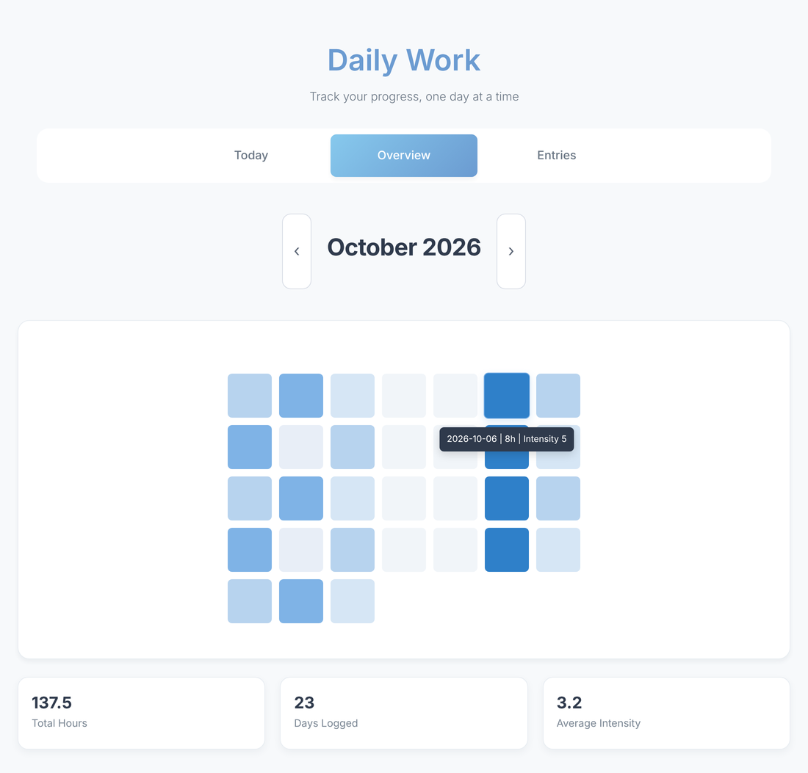
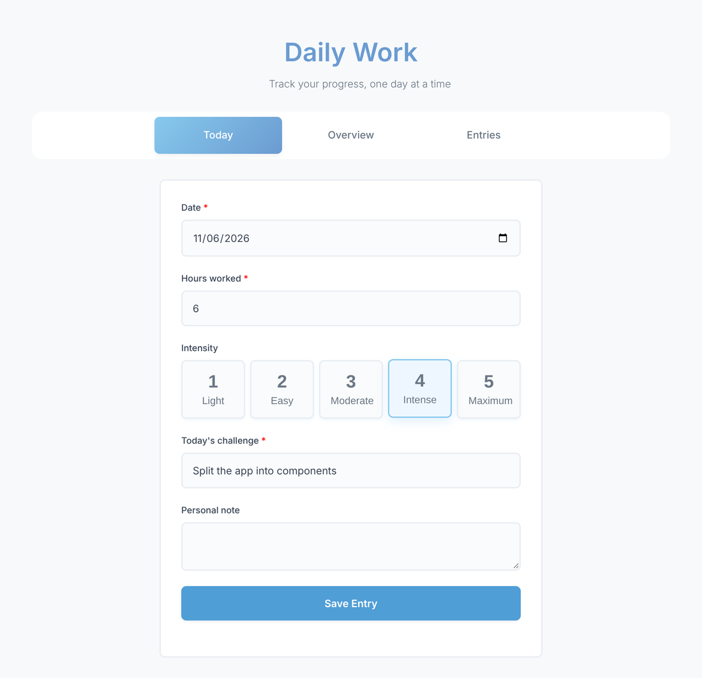
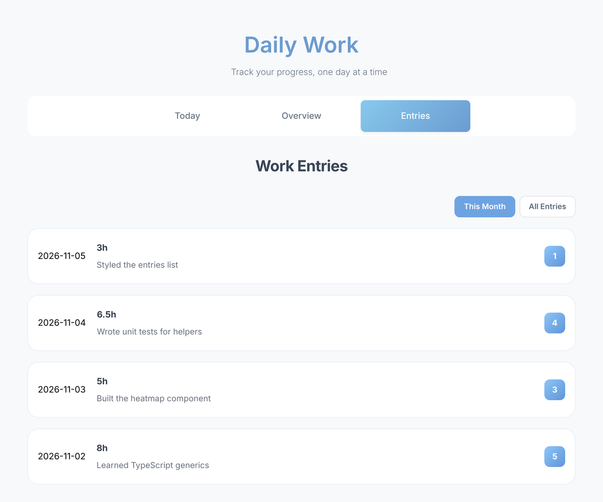

# 🚀 Daily Work (React)

Daily Work is a React application for tracking daily productivity: how many hours you worked, how intense the day was and what the main challenge was. A monthly heatmap shows your work pattern at a glance.

🌍 **Live demo:** [daily-work-react.vercel.app](https://daily-work-react.vercel.app)

> This is the third version of the same app:
> [daily-work](https://github.com/tijana333/daily-work) (vanilla JS) → [daily-work-ts](https://github.com/tijana333/daily-work-ts) (TypeScript) → **daily-work-react** (React)

<p align="center">
  
</p>

---

## ✨ Features

- **Log a day:** date, hours worked, intensity (1–5), today's challenge and an optional personal note
- **Smart date picker:** choosing a date that already has an entry loads it, and saving updates it instead of creating a duplicate
- **Validation:** required fields, hours between 0 and 24, no future dates, length limits
- **Monthly heatmap:** each day colored by intensity, with a tooltip and month navigation
- **Statistics:** total hours, days logged and average intensity for the month
- **Entries list:** this month or all entries, newest first
- **Entry details modal:** view, edit or delete an entry
- Loading, empty and error states
- Responsive design

---

## 📸 Screenshots

| Log today's work | Entries |
| --- | --- |
|  |  |

---

## 🛠️ Tech Stack

- **React 19** (hooks: `useState`, `useEffect`, `useCallback`, `useRef`)
- **React Router 7** for the Today / Overview / Entries pages
- **Vite** for development and builds
- **ESLint** with the React Hooks rules
- **CSS** (flexbox, grid, media queries)
- **REST API** backend, deployed on **Vercel**

---

## ⚙️ Getting Started

Requires a current LTS version of [Node.js](https://nodejs.org/).

```bash
git clone https://github.com/tijana333/daily-work-react.git
cd daily-work-react
npm install
npm run dev
```

Then open the address Vite prints (usually http://localhost:5173).

| Command | Description |
| --- | --- |
| `npm run dev` | Start the development server |
| `npm run build` | Build for production into `dist/` |
| `npm run preview` | Preview the production build |
| `npm run lint` | Run ESLint |

---

## 📁 Project Structure

```
src/
├── main.jsx                 # Renders the app inside BrowserRouter
├── App.jsx                  # Routes, tabs and shared state (selected / edited entry)
├── index.css                # All styles
├── api/
│   └── entriesApi.js        # All requests to the backend
├── components/
│   ├── EntryForm/           # "Today" page: create and update entries
│   ├── Heatmap/             # "Overview" page: heatmap and monthly stats
│   ├── EntriesList/         # "Entries" page: list with This Month / All Entries
│   ├── EntryCard/           # One entry in the list
│   └── EntryModal/          # Entry details with Edit and Delete
└── utils/
    └── dates.js             # Local date helpers (avoid UTC date shifts)
```

`vercel.json` sends every path to `index.html`, so routes like `/overview` also work when opened directly or refreshed.

---

## 🔌 API

All requests go through `src/api/entriesApi.js`.

| Method | Endpoint | Description |
| --- | --- | --- |
| `GET` | `/api/entries` | All entries |
| `GET` | `/api/entries?month=11&year=2026` | Entries for one month |
| `GET` | `/api/entries?date=2026-11-06` | Entry for one date |
| `POST` | `/api/entries` | Create an entry (`409` if the date already has one) |
| `PUT` | `/api/entries/:id` | Update an entry |
| `DELETE` | `/api/entries/:id` | Delete an entry |

---

## 🧠 What I Practiced

- Splitting a UI into reusable components
- Lifting state up and passing data with props
- `useEffect` for data fetching, with cleanup to ignore outdated responses
- Client-side routing with React Router
- CRUD operations against a REST API
- Form handling and validation in React
- Deployment on Vercel
- Git workflow with feature branches (`DWRJ-…`) and pull requests

---

## 👩‍💻 Author

**Tijana Đuknić**
[GitHub](https://github.com/tijana333) · [LinkedIn](https://www.linkedin.com/in/tijana-%C4%91ukni%C4%87-2175822b8/)
